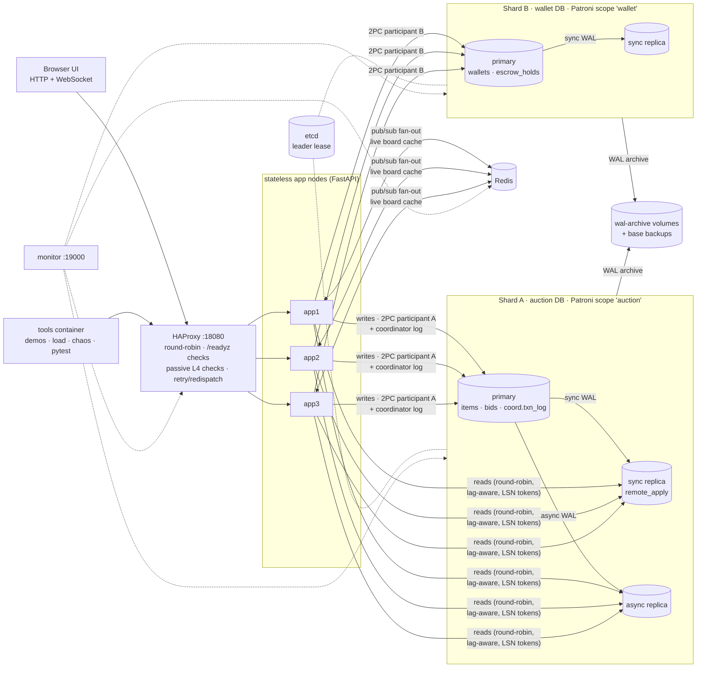

# Distributed Live Auction Engine

A real-time auction system built to **demonstrate six Advanced DBMS topics live, each with a
one-command, self-checking demo**: replication, fault tolerance, availability, distributed
transactions, recovery and load balancing. Everything runs locally with Docker Compose:
two PostgreSQL 16 clusters managed by Patroni, three stateless FastAPI nodes behind HAProxy,
Redis for live fan-out, and a monitoring dashboard.

* Design rationale, CAP trade-offs, 2PC blocking analysis, failure matrix → [`docs/REPORT.md`](docs/REPORT.md)
* Plan, decisions and port map → [`PLAN.md`](PLAN.md)
* Real output of every demo → [`docs/demo-output/`](docs/demo-output/)

---

## Quick start

Requirements: Docker Desktop (Compose v2), ~4 GB RAM for Docker, `make`. No local Python needed.

```bash
make up          # build images (first time ~2 min), start 12 containers, wait for health, seed data
make check       # verify: all healthy, 1 primary + sync + async, LB spreads evenly
make demo-all    # run every demo end-to-end (~4 min, 153 checks), outputs saved to docs/demo-output/
make down        # stop (data kept)   ·   make clean   # stop and delete all data
```

| URL | What |
|---|---|
| http://localhost:18080 | **Auction UI** (through HAProxy): pick a user, bid, watch live updates |
| http://localhost:19000 | **Cluster monitor**: primaries, replication lag, LB distribution, 2PC log, money invariant, event log |
| http://localhost:18404/stats | HAProxy statistics |

Host ports are in the 1xxxx range to avoid clashing with common local services (full map in [PLAN.md](PLAN.md#2-services--port-map)).

---

## Architecture



Roles inside each shard move on failover: any of `pg-a1..3` can be primary, sync or async;
apps discover the current layout from Patroni every second.

**A bid is one distributed transaction.** Shard A locks the item, validates the bid and inserts
it. Shard B releases the previous top bidder's escrow hold, checks the bidder's free funds and
places a new hold. Both parts are `PREPARE`d, and the decision is logged durably before
`COMMIT PREPARED` runs on both.

---

## The six topics: how, where, demo

Code comments tag every implementation site with `[T1]`…`[T6]` (`grep -rn "\[T4\]" app/`).

### 1 · Replication — `make demo-replication`

| | |
|---|---|
| **How** | Streaming replication with per-member replication slots. Shard A: one **synchronous** standby (`synchronous_commit=remote_apply`) + one **asynchronous**. Writes go only to the primary; reads go round-robin over replicas whose *replay* lag (from the primary's `pg_stat_replication`) is < 1 MB. **Read-your-writes**: every write returns `X-Write-LSN`; a read with `X-Min-LSN` uses a replica only if `pg_last_wal_replay_lsn() >= token`, else the primary. |
| **Where** | [infra/patroni/patroni.yml](infra/patroni/patroni.yml) (sync mode, WAL settings) · [app/auction/topology.py](app/auction/topology.py) (`REPLICATION_SQL`, `read_candidates`) · [app/auction/db.py](app/auction/db.py) (`read`, LSN check) · `GET /api/replication` |
| **Demo** | ① topology + `pg_stat_replication` ② a write appears on all 3 nodes ③ async replica made a delayed replica: sync replica current, async stale, commits not slowed ④ 30 reads without token → stale hits; with `X-Min-LSN` → 0 stale ⑤ sync replica delayed 500 ms → a 2PC bid (≈5 synchronous commits on Shard A) slows from 7 ms to ~2.5 s (cost of sync) |

```text
  pg-a1  async  sent_lag=0B  flush_lag=0B  replay_lag=21856B  replay_lag_ms=24.85
  WITHOUT session token  30 reads → served by {'pg-a1': 15, 'pg-a3': 15}  stale reads = 15
  WITH X-Min-LSN         30 reads → served by {'pg-a2': 15, 'pg-a3': 15}  stale reads = 0  fallbacks: {'replica-behind-min-lsn': 15}
  bid $40 → 200 after 2538 ms (vs 7 ms without the delay) ≈ 5 synchronous commits on Shard A, each waiting for the sync replica to apply
  ✔ every Shard A commit waited until the sync replica had applied it (synchronous_commit=remote_apply)
```

### 2 · Fault tolerance — `make demo-fault`

| | |
|---|---|
| **How** | **Circuit breakers** per DB member and for Redis (closed → open → half-open, doubling timeout): a dead replica leaves read rotation after 2 failures instead of costing every read a connect timeout. **Retries with exponential backoff** on transient errors: bid requests are retried server-side (safe thanks to idempotency keys), phase-2 commits are retried, the Redis subscriber reconnects with backoff. **Graceful degradation**: Redis down → events delivered locally, clients told to switch to HTTP polling, `/api/live` served from the DB. HAProxy retries/redispatches requests that hit a dying node. |
| **Where** | [app/auction/resilience.py](app/auction/resilience.py) · breakers in [topology.py](app/auction/topology.py) and [realtime.py](app/auction/realtime.py) · retry in [api.py](app/auction/api.py) (`place_bid`) · [infra/haproxy/haproxy.cfg](infra/haproxy/haproxy.cfg) |
| **Demo** | Under continuous load + 6 WebSocket watchers + an auction that ends mid-chaos: kill **app2**, then the **sync replica**, then **Redis**, then restore all. Proves every bid confirmed to a client is on the primary *and* every replica, the auction was settled exactly once, and invariants hold. |

```text
  steady          ok=1318  rejected=205  failed=0   committed bids=238
  app2 killed     ok=1722  rejected=260  failed=0   committed bids=284
  replica killed  ok=2368  rejected=404  failed=0   committed bids=420
  redis killed    ok=1728  rejected=279  failed=0   committed bids=308
  restore         ok=1625  rejected=243  failed=0   committed bids=300
  bids confirmed to clients: 1550   stored on primary: 1550
  ✔ clients told to poll while Redis was down, back to push after
```

### 3 · Availability — `make demo-failover` (`SHARD=A` or `B`, default both)

| | |
|---|---|
| **How** | **Patroni** holds each shard's leader lease in etcd (ttl 10 s). When the primary's machine dies the lease expires and the **sync standby** is promoted (no acknowledged commit can be lost); apps see the new leader within 1 s; the old primary rejoins as a replica via **`pg_rewind`** (no split-brain: a primary that can't renew its lease demotes itself). Reads continue from replicas throughout. Every node exposes `/healthz` (liveness) and `/readyz` (can serve reads; reports write availability separately, so a DB failover doesn't take app nodes out of the LB). |
| **Where** | [infra/patroni/](infra/patroni/) · [topology.py](app/auction/topology.py) (`refresh`, `_set_leader`, `is_usable_replica`) · [main.py](app/auction/main.py) (`/healthz`, `/readyz`) |
| **Demo** | 4 bidders + 4 readers; `docker kill` the primary; per-second success/fail; measured **write downtime**; a probe asks every member `pg_is_in_recovery()` every 250 ms (never two writable primaries); old primary restarted → rejoins via `pg_rewind` on the new timeline; no confirmed bid lost. |

```text
  Patroni promoted pg-a1 9.9s after the kill (the former sync standby)
  WRITE DOWNTIME: 10.2s  (last commit -0.0s, first commit after failover +10.2s relative to the kill)
  reads during the 15 s after the kill: ok=4199 failed=0  served by {'pg-a1': 1419, 'pg-a3': 2780}
      pg_rewind exit code=0
      stderr=pg_rewind: servers diverged at WAL location 0/65B9640 on timeline 1
      starting as a secondary
  split-brain probe: 122 samples; writable primaries over time: ['pg-a2'] → ['none'] → ['pg-a1']
  bids: confirmed to clients=2110 stored=2110
  ✔ no confirmed bid lost across the failover (missing 0)
```

### 4 · Distributed transactions — `make demo-dtx`, `make check-invariants`

| | |
|---|---|
| **How** | **Two-phase commit** over PostgreSQL's `PREPARE TRANSACTION` on both shards, coordinated by whichever app node received the request. The coordinator log `coord.txn_log` (INIT → PREPARED → COMMITTED / ABORTED) lives in the sync-replicated Shard A cluster; the decision is a **compare-and-set** so recovery and a slow coordinator can never disagree. **Concurrency**: item row `SELECT … FOR UPDATE` (held by the prepared txn until commit, so bids on one item serialize) and wallets locked in `user_id` order (deadlock-free); validation uses only the locked row. **Idempotency-Key** is UNIQUE and re-checked after the lock. Auction close = 2PC settlement of the winner's escrow to the seller. |
| **Where** | [app/auction/coordinator.py](app/auction/coordinator.py) · [bidding.py](app/auction/bidding.py) · [closer.py](app/auction/closer.py) (`settle`) · schemas [infra/sql/](infra/sql/) · invariant checker [demo/invariants.py](demo/invariants.py) |
| **Demo** | (a) normal bid, and the protocol watched from outside with phase 2 delayed (COMMITTED while both still PREPARED) (b) insufficient funds → Shard B votes NO → A's prepared part rolled back (c1) B fails at PREPARE → global abort (c2) B unreachable in phase 2 → resolver commits it (d) **100 concurrent bids** on one item + 20 identical bids on one price slot → exactly one winner (e) 5 parallel retries with one key → one bid, retries get the original result. Then invariants. |

```text
  t= 0.0s state=COMMITTED completed=False prepared A/B=1/1  visible price=$50 user4 held=$24
  t= 2.2s state=COMMITTED completed=True  prepared A/B=0/0  visible price=$60 user4 held=$84
  resolver committed Shard B's part 6.2s later; txn_log completed=True
  100 bids in 0.34s → {'accepted': 4, 'bid_too_low': 96}  via {'app2': 34, 'app1': 33, 'app3': 33}
  20 concurrent bids of exactly $100 → {'accepted': 1, 'bid_too_low': 19}
  responses: {'accepted': 1, 'duplicate': 4}
  ✔ M1 money conserved: Σ balance 10000.00 == supply 10000.00
```

### 5 · Recovery — `make demo-recovery`

| | |
|---|---|
| **How** | **Coordinator recovery**: every node runs a resolver at startup and every 3 s that matches `pg_prepared_xacts` on both shards against the log: COMMITTED → `COMMIT PREPARED`, otherwise → CAS to ABORTED and `ROLLBACK PREPARED` (presumed abort). Own transactions are resolved immediately after a restart; other nodes' after a 5 s grace period. **DB crash recovery**: WAL redo on restart (Patroni restarts the killed postmaster). **PITR**: continuous WAL archiving to a shared volume + `pg_basebackup`; restore into a sandbox with `recovery_target_time`, copy the lost rows back. **Redis loss**: Redis runs without persistence; the live board is rebuilt from the DB on every reconnect. |
| **Where** | [app/auction/recovery.py](app/auction/recovery.py) · fault hooks [faults.py](app/auction/faults.py) · [infra/patroni/archive_wal.sh](infra/patroni/archive_wal.sh) · [realtime.py](app/auction/realtime.py) (`rebuild_board`) · [demo/demo_recovery.py](demo/demo_recovery.py) (`restore_sandbox`) |
| **Demo** | 1a `kill -9` before the decision → rolled back · 1b after COMMITTED → committed, client retry exactly-once · 1c external SIGKILL mid-phase-2 → a new bid **blocks** (2PC blocking) until a surviving node resolves it · 2 SIGKILL all postgres processes under load → WAL redo, 0 lost · 3 `DELETE FROM bids` → PITR · 4 Redis restart → board rebuilt |

```text
  app3 back after 0.8s → log=ABORTED; prepared A=0 B=0
    app3 recovery WARNING resolved in-doubt e613a2d6-… on shard A -> COMMIT PREPARED (log=COMMITTED, age 0.8s)
  client retries the same request via HAProxy → 200 status=duplicate
  bid $60 via app1 → 200 accepted after waiting 4.8s
    app1 recovery WARNING resolved in-doubt 5b1362ef-… on shard A -> COMMIT PREPARED (log=COMMITTED, age 6.0s)
    LOG:  redo starts at 0/662C688
    LOG:  redo done at 0/80FF8E8 system usage: CPU: user: 0.02 s, system: 0.01 s, elapsed: 0.03 s
  💥 accident: DELETE FROM bids → DELETE 7594; bids now: 0
    sandbox recovery stopping before commit of transaction 68499, time 2026-11-23 19:02:06.404542+00
  sandbox recovered in 1.3s: 7594 bids as of 2026-11-23 19:02:05.393768+00:00
```

### 6 · Load balancing — `make demo-lb`

| | |
|---|---|
| **How** | HAProxy round-robins HTTP and WebSocket connections over app1–3 with **active** `/readyz` checks (1 s, fall 2 / rise 2) and **passive** checks (first L4 error on live traffic marks a node down), DNS re-resolution for restarted containers, and request retry/redispatch. Inside the app, **read/write splitting**: writes → primary, reads → replicas round-robin. Every response carries **`X-Served-By`** (and `X-DB-Node`); the UI shows both. Bids placed via any node reach clients on every node through **Redis pub/sub**. |
| **Where** | [infra/haproxy/haproxy.cfg](infra/haproxy/haproxy.cfg) · [topology.py](app/auction/topology.py) (`primary`, `replica`) · [main.py](app/auction/main.py) (`X-Served-By` middleware) · [realtime.py](app/auction/realtime.py) |
| **Demo** | Load spread per app node and per DB node; kill app2 → removed in 0.7 s, 0 failed requests; restart → re-added; 6 WebSocket clients land on all 3 nodes and each sees bids placed via every node. |

```text
  app nodes: app1=645 app2=631 app3=636
  reads by DB node: pg-a1=754 pg-a3=745   writes by DB node: pg-a2=276
  HAProxy marked app2 DOWN 0.7s after the kill  (app1=UP  app2=DOWN  app3=UP)
  ✔ failed requests while app2 died: 0
  ✔ client on app2 saw all 3 bids: $11←app1, $12←app2, $13←app3
```

---

## Commands

| Target | |
|---|---|
| `make up` / `down` / `clean` | start (seeded) · stop · stop and wipe volumes |
| `make check`, `make status` | stack health check · Patroni cluster tables |
| `make demo-replication` · `demo-fault` · `demo-failover` · `demo-dtx` · `demo-recovery` · `demo-lb` | the six topic demos (each exits non-zero if any check fails) |
| `make demo-all` | all demos from fresh seed data + summary; outputs → `docs/demo-output/` |
| `make check-invariants` | money / cross-shard consistency proof |
| `make load DURATION=30` | load generator with per-second stats |
| `make test` | pytest (unit + integration; **resets demo data**) |
| `make seed RESET=1` | wipe and reseed |
| `make redeploy` | rebuild/restart app + monitor only (DBs untouched) |

## Repository layout

```
app/auction/      FastAPI node: topology (R/W split, failover), coordinator (2PC), recovery,
                  realtime (Redis + WebSocket), resilience (breaker/retry), closer, faults, UI
monitor/          dashboard service
infra/patroni/    PostgreSQL 16 + Patroni image, config, archive script, bootstrap
infra/sql/        Shard A + Shard B schemas
infra/haproxy/    load balancer config
demo/             demos, load generator, seed, invariant checker, demo-all
tests/            pytest: unit, 2PC paths, idempotency + concurrency, recovery logic
docs/             REPORT.md, demo-output/
```

## Testing

`make test` runs 30 tests inside the tools container against the live stack (it reseeds first):
unit tests for validation, fault hooks and replica selection; 2PC commit/abort/vote-no/phase-2
loss; idempotency (sequential and parallel retries, rejected attempts don't burn the key);
concurrency (one winner per price slot, single highest under 50 concurrent bids, wallet can't be
over-committed across items); recovery (crash before/after decision, resolver follows the log
for every state, grace period, recovery abort beats a slow coordinator).

## Troubleshooting

* **Port already in use** → change the left side of the `ports:` mapping in `docker-compose.yml`.
* **A demo failed half-way** → `make up` (restarts anything stopped), then rerun; `make check-invariants` tells you whether data is consistent; `make seed RESET=1` gives a clean slate.
* **Patroni cluster stuck after a crash of Docker itself** → `make clean && make up`.
